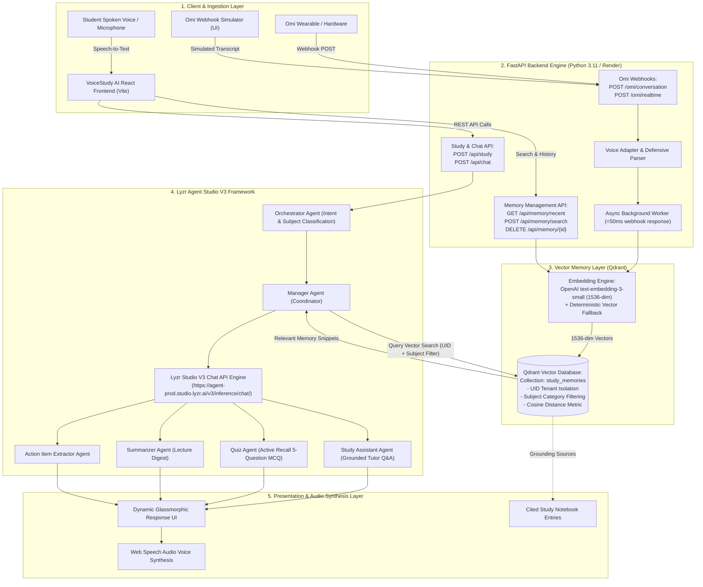
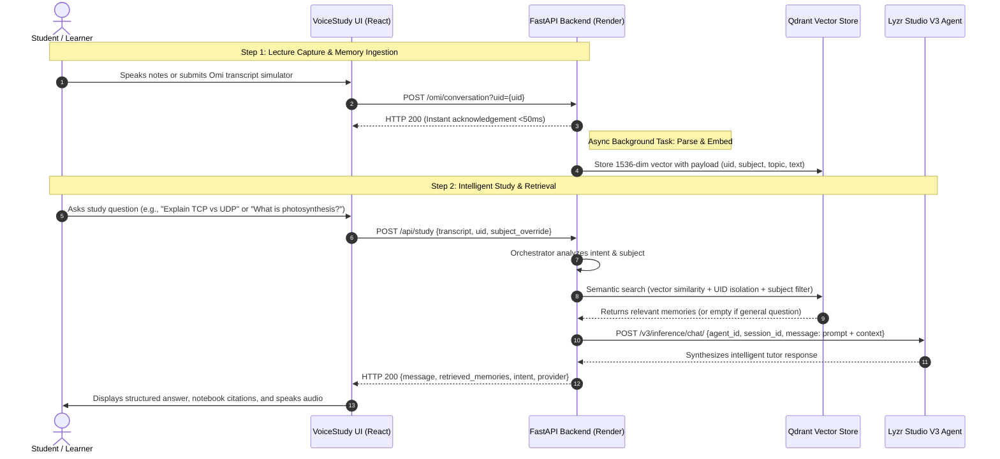

# VoiceStudy AI — System Architecture & Workflow

> **AI House × HiDevs Hackathon — Meeting & Lecture Intelligence**  
> **Integrated Stack:** Omi Voice Hardware & Simulator × Qdrant Vector Memory × Lyzr AI Multi-Agent Studio

---

## 1. High-Level System Architecture

---

## 2. End-to-End Workflow Execution Sequence

---

## 3. Technology Integration Verification

| Component | Integrated Technology | Implementation File | Verification Status |
| :--- | :--- | :--- | :--- |
| **Voice Input** | Omi Wearable Webhook API | [`backend/routes/omi.py`](file:///d:/Projects/VOICESTUDY%20AI/backend/routes/omi.py), [`backend/services/omi_parser.py`](file:///d:/Projects/VOICESTUDY%20AI/backend/services/omi_parser.py) | **Verified** (Fast HTTP 200, non-blocking background persistence) |
| **Vector Memory** | Qdrant Vector Database | [`backend/memory/qdrant_service.py`](file:///d:/Projects/VOICESTUDY%20AI/backend/memory/qdrant_service.py) | **Verified** (1536-dim embeddings, UID isolation, keyword + subject filters) |
| **AI Agents** | Lyzr Studio V3 Agents | [`backend/services/lyzr_agent_framework.py`](file:///d:/Projects/VOICESTUDY%20AI/backend/services/lyzr_agent_framework.py), [`backend/agents/`](file:///d:/Projects/VOICESTUDY%20AI/backend/agents) | **Verified** (Live Lyzr V3 HTTP 200 calls, unique session isolation) |
| **Frontend UI** | React + Vite Single Page App | [`frontend/src/`](file:///d:/Projects/VOICESTUDY%20AI/frontend/src) | **Verified** (Glassmorphic dark UI, speech synthesis, subject filtering) |
