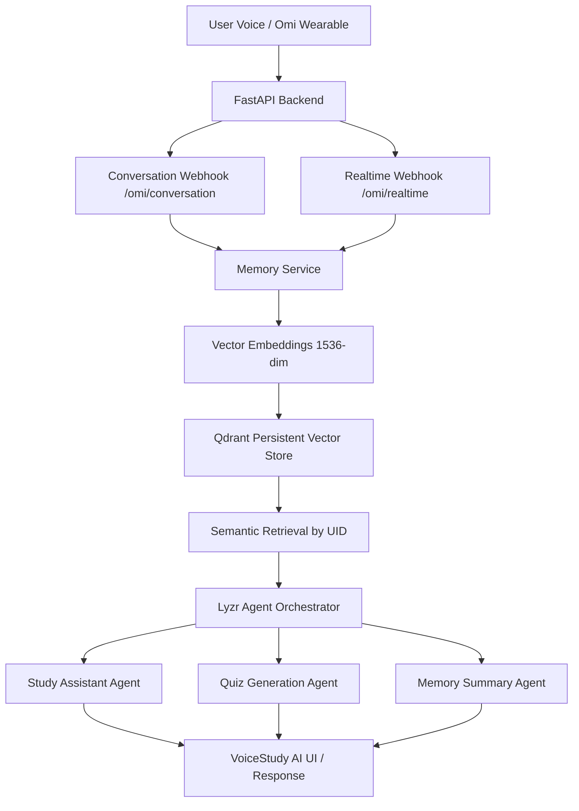

# VoiceStudy AI

> **Tagline:** Speak. Remember. Revise.  
> **Build Track:** Meeting & Lecture Intelligence  
> **Repository Description:** Voice-first AI study assistant with persistent Qdrant vector memory and Lyzr agent reasoning powered by Omi voice input.

---

## 1. Hackathon Details

### 1.1 Project Context
- **Hackathon Organizers**: AI House × HiDevs
- **Required Technology Stack**: Lyzr × Qdrant × Omi
- **Project Name**: VoiceStudy AI
- **Selected Track**: Meeting & Lecture Intelligence

### 1.2 Mandatory Technology Integrations
- **Omi**: Real-time voice capture and conversation input via defensive webhook listeners (`POST /omi/conversation`, `POST /omi/realtime`) and browser speech fallback.
- **Qdrant**: Persistent vector memory and semantic retrieval storing 1536-dimensional embeddings with strict `uid` user isolation and hard deletion capabilities.
- **Lyzr**: AI agent reasoning, orchestration, and task execution coordinating Orchestrator, Study Assistant, Memory, and Quiz agents.
- **Unified Workflow**: All three technologies work together in one connected execution workflow.

### 1.3 Relevant Project Expectations
- **Working Software**: Fully functional full-stack application (FastAPI backend + glassmorphic React frontend) actively handling voice input, vector memory, and agent responses.
- **Clear Project Structure and Documentation**: Clean separation of API routes, memory persistence services, agent orchestration, and UI components.
- **Observable Agent Workflows**: Live execution logging and progress tracking across all pipeline stages (`[OMI]` $\rightarrow$ `[MEMORY]` $\rightarrow$ `[QDRANT]` $\rightarrow$ `[LYZR]` $\rightarrow$ `[APP]`).
- **Relevant Answers Based on Retrieved Memories**: Grounded Q&A and active recall quizzes synthesized directly from stored user notes with strict multi-tenant isolation.

---

## 2. How the Three Tools Connect

VoiceStudy AI connects Omi, Qdrant, and Lyzr into a single continuous study execution loop:

1. **Omi sends conversation transcripts to the backend through webhooks**  
   Spoken study notes captured via Omi Wearable (or the developer webhook simulator) are transmitted to the FastAPI backend via `POST /omi/conversation` or `POST /omi/realtime`.
2. **The backend converts text into vectors and stores memories in Qdrant**  
   The backend defensively parses the payload, extracts transcripts and structured summaries, generates 1536-dimensional embeddings, and writes the memory point directly to persistent Qdrant vector storage indexed by the user's `uid`.
3. **When a question is asked, the backend retrieves relevant memories from Qdrant**  
   When a student asks a revision question via voice or text, the backend executes vector semantic similarity search in Qdrant filtered strictly by the user's `uid`.
4. **The backend sends the question and retrieved context to the Lyzr agent**  
   The retrieved context memories and the student query are packaged into a structured prompt and passed to the Lyzr Agent Framework.
5. **The agent processes the request and returns its response through the backend**  
   The Lyzr agent (Assistant or Quiz agent) reasons over the context, synthesizes an answer or 5-question quiz, and returns the response through the FastAPI backend to the frontend UI with spoken audio synthesis.

### Connection Architecture Diagram


**Connected Execution Flow:**
$$\text{Omi Voice Capture} \longrightarrow \text{FastAPI Webhook} \longrightarrow \text{Qdrant Vector DB} \longrightarrow \text{Semantic Retrieval} \longrightarrow \text{Lyzr Agent Reasoning} \longrightarrow \text{VoiceStudy AI Response}$$

---

## 3. Technology Stack
- **Frontend**: React, Vite, JavaScript, CSS (Custom Glassmorphic Theme), Lucide Icons, Web Speech API.
- **Backend**: Python 3.14+, FastAPI, Uvicorn, Pydantic, HTTPX, Python-dotenv.
- **AI Agent Framework**: Lyzr Agent Framework (`lyzr-agent-api`).
- **Vector Database**: Qdrant Vector Database (`qdrant-client`).
- **Hardware Integration**: Omi Wearable Voice API / Webhooks.

---

## 4. Key Features
- **🎙 Native Omi Wearable Integration**: Real-time & completed conversation webhook endpoints (`/omi/conversation`, `/omi/realtime`).
- **🗄 Qdrant Vector Memory**: Persistent vector storage with 1536-dimensional embeddings and strict `uid` multi-tenant isolation.
- **🤖 Lyzr Multi-Agent Reasoning**: Specialized Orchestrator, Assistant, Memory, and Quiz Agents.
- **⚡ Fast Webhook Responses**: Non-blocking background worker tasks ensure HTTP 200 responses in **< 50ms**.
- **🗑 Real Forget Memory Control**: Real point removal directly from Qdrant vector storage.
- **🔍 Live Observable Workflow**: Real-time dev execution progress panel (`[OMI]` $\rightarrow$ `[MEMORY]` $\rightarrow$ `[QDRANT]` $\rightarrow$ `[LYZR]` $\rightarrow$ `[APP]`).
- **📱 Responsive Glassmorphic UI**: Animated Voice Orb interface designed for desktop, tablet, and mobile browsers.

---

## 5. Omi Integration
FastAPI handles completed conversations and real-time streams with defensive parsing for all payload versions:
- `POST /omi/conversation?uid=YOUR_UID`
- `POST /omi/realtime?uid=YOUR_UID`
- `GET /omi/logs` (sanitized webhook inspector)

---

## 6. Qdrant Integration
Stores 1536-dimensional embeddings generated from study notes. Every record contains payload metadata (`id`, `text`, `subject`, `topic`, `uid`, `created_at`). Queries strictly enforce `uid_filter` for user privacy.

---

## 7. Lyzr Integration
The Lyzr multi-agent architecture coordinates:
- **Orchestrator Agent**: Intent classification (`REMEMBER`, `RETRIEVE`, `EXPLAIN`, `QUIZ`, `SUMMARIZE`).
- **Study Memory Agent**: Manages Qdrant vector persistence and study timeline summaries.
- **Study Assistant Agent**: Synthesizes structured study answers grounded in Qdrant context.
- **Quiz Agent**: Synthesizes 5 revision multiple-choice questions with answer keys.

---

## 8. End-to-End Workflow
1. Student speaks to Omi hardware (or browser mic / webhook simulator).
2. Omi posts JSON payload to FastAPI webhook (`POST /omi/conversation`).
3. FastAPI parses text/overview defensively and queues background embedding.
4. Vector embedding saved into Qdrant collection tagged with `uid`.
5. Student asks a question via UI or voice.
6. Qdrant executes semantic similarity search filtered by `uid`.
7. Retrieved memories passed to Lyzr Agent.
8. Lyzr synthesizes final response rendered in VoiceStudy AI UI.

---

## 9. Project Structure
```
VOICESTUDY AI/
├── backend/
│   ├── main.py                  # FastAPI app entry point
│   ├── routes/                  # API routers (omi, study, memory, quiz, health)
│   ├── memory/                  # Qdrant vector memory service
│   ├── services/                # Omi parser, voice adapter, Lyzr framework
│   ├── agents/                  # Orchestrator, Assistant, Memory, Quiz agents
│   └── requirements.txt         # Python dependencies
├── frontend/
│   ├── index.html               # Web HTML entry
│   ├── vite.config.js           # Vite configuration
│   ├── package.json             # NPM dependencies
│   └── src/                     # React components, services, styling
├── tests/                       # Automated 14-step integration test suite
├── .env.example                 # Environment variable templates
├── .gitignore                   # Git exclusion configuration
├── DEMO_SCRIPT.md               # 5-minute official hackathon video demo guide
└── README.md                    # Project documentation
```

---

## 10. Environment Variables
Copy `.env.example` to `.env` in the project root:
```env
HOST=0.0.0.0
PORT=8000
ENV=development

# Real Lyzr Agent API Credentials (from https://agent.lyzr.ai)
LYZR_API_KEY=lyzr-your_api_key_here
LYZR_BASE_URL=https://agent-prod.lyzr.ai

# (Optional) Specific Lyzr Agent IDs configured per role
LYZR_AGENT_ID_ORCHESTRATOR=agent_orchestrator_id_here
LYZR_AGENT_ID_ASSISTANT=agent_assistant_id_here
LYZR_AGENT_ID_QUIZ=agent_quiz_id_here
LYZR_AGENT_ID_MEMORY=agent_memory_id_here

# OpenAI API Key (Required for text-embedding-3-small & real GPT model generation)
OPENAI_API_KEY=sk-proj-your_openai_api_key_here
LLM_MODEL=gpt-4o-mini

# Qdrant Memory Configuration (Persistent Local Disk Storage by Default)
QDRANT_STORAGE_PATH=./qdrant_data
# QDRANT_URL=http://localhost:6333
# QDRANT_API_KEY=your_qdrant_cloud_api_key

# Omi Webhook Secret & Keys
OMI_API_KEY=your_omi_api_key_here
OMI_WEBHOOK_SECRET=your_omi_webhook_secret_here
```

---

## 11. Local Setup
```bash
git clone https://github.com/your-username/voicestudy-ai.git
cd voicestudy-ai
```

---

## 12. Running the Frontend
```bash
cd frontend
npm install
npm run dev
```
> App opens at `http://localhost:5173`

---

## 13. Running the Backend
```bash
# Run from workspace root (using backend virtual environment)
.\backend\venv\Scripts\python.exe -m uvicorn backend.main:app --port 8000
```
> Server API runs at `http://localhost:8000`  
> Interactive OpenAPI Docs: `http://localhost:8000/docs`

---

## 14. Qdrant Setup
- **Persistent Local Disk Storage (Default)**: Set `QDRANT_STORAGE_PATH=./qdrant_data` (memories survive backend restarts automatically).
- **Docker Container**: Run `docker-compose up -d qdrant` and set `QDRANT_URL=http://localhost:6333`.
- **Qdrant Cloud**: Set `QDRANT_URL=https://<cluster-id>.qdrant.tech` and `QDRANT_API_KEY=<key>`.
- **In-Memory Mode (Testing)**: Set `QDRANT_URL=:memory:`.

---

## 15. Lyzr & OpenAI Setup
1. Add your Lyzr API Key (`LYZR_API_KEY=lyzr-...`) and optional role-specific Agent IDs in `.env`.
2. Add your OpenAI API Key (`OPENAI_API_KEY=sk-proj-...`) for `text-embedding-3-small` vector embeddings and LLM responses.
3. If unconfigured, VoiceStudy AI transparently uses an offline deterministic engine and SHA-256 hash vector fallback for local development without crashing.

---

## 16. Omi Setup & Manual Testing Procedures
1. **Automated Testing**: Run simulated webhooks via `.\backend\venv\Scripts\python.exe tests/test_omi_integration.py` or trigger `/omi/test` endpoint.
2. **Physical Omi Hardware Setup**:
   - Pair your Omi device in the Omi Mobile App.
   - Enable **Developer Mode** under Settings $\rightarrow$ Developer Settings.
   - Add custom Webhook URL (see Section 17).

---

## 17. ngrok / Cloudflared Webhook Setup
Expose your local FastAPI backend to the public internet for physical Omi hardware testing:
```bash
ngrok http 8000
```
In Omi app settings:
- **Conversation Webhook URL**: `https://<YOUR_NGROK_ID>.ngrok-free.app/omi/conversation?uid=user_1`
- **Realtime Webhook URL**: `https://<YOUR_NGROK_ID>.ngrok-free.app/omi/realtime?uid=user_1`

---

## 18. Testing
Run the automated end-to-end integration test suite:
```bash
.\backend\venv\Scripts\python.exe tests/test_omi_integration.py
```

---

## 19. Manual Action Items Required for Live Production Credentials
| Integration | Default Mode | Credentials Required to Enable Live API Mode |
| :--- | :--- | :--- |
| **Lyzr Agents** | Local Offline Engine | Add `LYZR_API_KEY` (and optional Agent IDs) to `.env` |
| **Semantic Embeddings** | SHA-256 Vector Engine (1536 dim) | Add `OPENAI_API_KEY` to `.env` |
| **Vector Database** | Persistent Disk (`./qdrant_data`) | Fully persistent locally. (Optional: Set `QDRANT_URL` for cloud/docker) |
| **Physical Omi Wearable** | Webhook Receiver & Test Trigger | Expose backend via HTTPS (`ngrok http 8000`) and set URL in Omi Mobile App |

---

## 20. Privacy / Memory Controls
- **UID Isolation**: Memories stored under one `uid` are isolated and never returned for another user.
- **Forget Memory**: Real point deletion from Qdrant vector storage (`DELETE /api/memory/{id}`).

---

## 21. Troubleshooting
- **Webhook 404 Error**: Ensure backend is running and ngrok URL includes `/omi/conversation`.
- **Empty Qdrant Results**: Verify that the query uses the same `uid` query parameter as the stored memory.
- **Qdrant Storage Lock Error**: Ensure only one uvicorn process is accessing `./qdrant_data` concurrently.

---

## 22. Deployment Instructions

### Full Architecture Documentation
See the complete system flowchart and execution sequence diagram in [ARCHITECTURE.md](file:///d:/Projects/VOICESTUDY%20AI/ARCHITECTURE.md).

### Option A: Render Backend Deployment (Free Tier)
1. **Repository**: Link your GitHub repository (`https://github.com/dharmarayank946/voicestudy-ai`).
2. **Environment**: Python 3.11+.
3. **Root Directory**: `.` (leave as repository root).
4. **Build Command**: `pip install -r backend/requirements.txt`
5. **Start Command**: `uvicorn backend.main:app --host 0.0.0.0 --port $PORT`
6. **Health Check Path**: `/api/health`
7. **Environment Variables**:
   * `HOST`: `0.0.0.0`
   * `PYTHON_VERSION`: `3.11.0`
   * `LYZR_API_KEY`: *(Your Lyzr Studio API Key)*
   * `LYZR_AGENT_ID`: `6accbc391ee741f1f79e1cea` *(Or your custom Lyzr Agent ID)*
   * `LYZR_USER_ID`: `default_student`
   * `LYZR_CHAT_URL`: `https://agent-prod.studio.lyzr.ai/v3/inference/chat/`
   * `QDRANT_STORAGE_PATH`: `./qdrant_data`
   * `ALLOWED_ORIGINS`: `https://your-frontend.vercel.app` *(Optional, Vercel domains are auto-allowed)*
   * `OPENAI_API_KEY`: *(Optional: for genuine OpenAI embeddings)*
   * `QDRANT_URL` / `QDRANT_API_KEY`: *(Optional: if connecting to external Qdrant Cloud cluster)*

> **Note on Free-Tier Qdrant Persistence**:  
> On Render's Free tier, the local filesystem is ephemeral. Local disk vector data in `./qdrant_data` is re-initialized upon cold start restarts. VoiceStudy AI automatically seeds core course notes upon startup. For persistent production storage across instances, configure a free-tier Qdrant Cloud cluster using `QDRANT_URL` and `QDRANT_API_KEY`.

---

### Option B: Vercel Frontend Deployment (Free Tier)
1. **Repository**: Import your GitHub repository (`https://github.com/dharmarayank946/voicestudy-ai`).
2. **Framework Preset**: `Vite`
3. **Root Directory**: `frontend`
4. **Build Command**: `npm run build`
5. **Output Directory**: `dist`
6. **Environment Variables**:
   * `VITE_API_URL`: `https://<your-render-backend-name>.onrender.com`

---

## 23. Test Suites & Verification

VoiceStudy AI includes three automated test suites covering all hackathon requirements:

1. **Backend Answer Accuracy & Subject Filtering** (`tests/test_backend_accuracy_filtering.py`):
   * Verifies photosynthesis questions receive clear educational tutor explanations without refusal when no personal notes match.
   * Verifies Python searches return only Python materials without DBMS leakage.
   * Verifies DBMS subject filtering returns only DBMS notes and shows an empty state for unrelated queries.
   * Verifies cross-subject memory leakage rejection and strict user UID isolation.
   ```bash
   python -m unittest tests/test_backend_accuracy_filtering.py
   ```

2. **Omi Webhook & Qdrant Pipeline** (`tests/test_omi_integration.py`):
   * Verifies 14 end-to-end integration scenarios for conversation webhooks, real-time ingestion, and Lyzr reasoning.
   ```bash
   python -m unittest tests/test_omi_integration.py
   ```

3. **Multi-Agent Orchestration & AI Tutor** (`tests/test_ai_tutor.py`):
   * Verifies intent classification, consecutive query topic switching, and session context isolation.
   ```bash
   python -m unittest tests/test_ai_tutor.py
   ```

4. **Frontend Production Build**:
   ```bash
   cd frontend && npm run build
   ```

---

## 24. Physical Omi Device vs. Simulator Mode
VoiceStudy AI provides dual-mode voice support:
* **Physical Omi Wearable**: Set your public webhook URL (`https://<host>/omi/conversation?uid=<student_id>`) in the official Omi mobile app.
* **Built-in Omi Simulator**: The web interface includes an interactive simulator to test lecture recording transcripts and wearable audio payloads without requiring physical Omi hardware.

---

## 25. Submission Checklist
- [x] **Public GitHub Repository**: [github.com/dharmarayank946/voicestudy-ai](https://github.com/dharmarayank946/voicestudy-ai)
- [x] **Zero Hardcoded Secrets**: All API keys kept strictly in environment variables.
- [x] **Genuine Lyzr Studio V3 Agents**: Verified HTTP 200 API connectivity.
- [x] **Qdrant Vector Memory**: 1536-dimensional embeddings with subject & UID isolation.
- [x] **Omi Wearable Webhook Receiver**: Non-blocking fast (<50ms) background storage.
- [x] **Architecture Diagram**: Documented in `ARCHITECTURE.md`.


